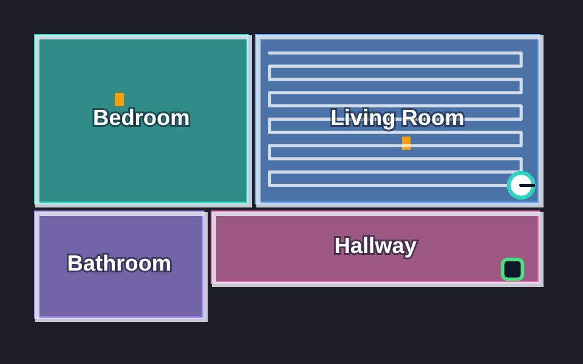

# EZVIZ RS20 for Home Assistant

[](https://hacs.xyz/docs/faq/custom_repositories)
[](https://github.com/stefanelul2000/ha-ezviz-rs20/releases)

[](LICENSE)
[](https://github.com/stefanelul2000/ha-ezviz-rs20/actions/workflows/tests.yml)
[](https://github.com/stefanelul2000/ha-ezviz-rs20/actions/workflows/validate.yml)

Full control of an **EZVIZ RS20** robot vacuum and its base station from Home
Assistant: a live map, room cleaning, every cleaning setting the app offers,
consumables and history.

<p align="center">
  
  <br><sub>The live map, drawn by the integration (example floor plan).</sub>
</p>

Developed and tested with an **RS20 Max**. Other EZVIZ robots are detected
and will often work, but are untested; see [Supported models](#supported-models).

> [!NOTE]
> EZVIZ does not publish an API for its robots. This integration talks to the
> same cloud endpoints as the EZVIZ app, so a firmware or cloud change can
> break a feature. The robot cannot be controlled locally.

## Contents

- [Supported models](#supported-models)
- [Features](#features)
- [Requirements](#requirements)
- [Installation](#installation)
- [Room cleaning](#room-cleaning)
- [The map](#the-map)
- [Good to know](#good-to-know)
- [Services](#services)
- [Troubleshooting](#troubleshooting)
- [Development](#development)
- [Credits and license](#credits-and-license)

## Supported models

| Model | Status | Notes |
|---|---|---|
| RS20 Max | ✅ Tested | Firmware V2.0.2417. Everything in this README. |
| RS20 Pro | 🟡 Very likely | Its app plugin uses the same commands as the RS20 Max. |
| RS2, RE4, RE5 | 🟡 Partly | Same cleaning and suction commands; no base-station or do-not-disturb settings. |
| RE7 Edge | 🟠 Partly | Start, stop and dock match; suction and water use different commands, not supported yet. |
| RS2 (manufacturer variant) | 🟠 Partly | Uses differently named start and dock commands, not supported yet. |
| RE3 Plus | ❓ Unknown | EZVIZ did not return an app plugin for it. |

Settings only appear when the robot reports them, so a model without, say,
carpet settings simply won't get those switches. The comparison behind this
table is in [docs/models.md](docs/models.md).

**Have a robot that isn't marked tested?** Please
[report how it works](https://github.com/stefanelul2000/ha-ezviz-rs20/issues/new?template=model_report.yml).
A few minutes with the form tells us what to fix for your model.

## Features

### Cleaning

| | |
|---|---|
| **Control** | Start, pause, resume, stop and send to the dock. A paused clean is resumed, as in the app. |
| **State** | Follows the robot's live task: cleaning, paused, returning, docked, idle or error. |
| **Suction** | Quiet, Normal, Strong or Max, from the vacuum entity. Changes apply straight away, even mid-clean. |
| **Mode** | Vacuum only, mop only, vacuum and mop, or vacuum then mop. |
| **Water and passes** | Water level (low, medium, high) and 1–3 cleaning passes. |
| **Rooms** | Clean one or more rooms through Home Assistant areas. Optional per-room suction, water and passes. |
| **Errors** | Robot errors in plain English, with the error code. |

### Map

A live image of the robot's active map: rooms in colour with their names,
walls, obstacles, the dock, the robot and the path of the current clean. See
[The map](#the-map).

### Settings

- **Do not disturb:** on or off, start and end time, and whether an
  interrupted clean resumes afterwards.
- **Schedules** made in the app: turn each on or off and change its start
  time.
- **Carpets:** detection, suction boost, extra cleaning, and crossing carpets
  only when there is no other path.
- **Mop:** wash after an interval or after each room, wash interval and
  drying time.
- **Dust:** how often the station empties the robot's bin.
- **Extras:** pet mode, smart dirt detection, debris boost, deep edge
  cleaning, voice volume and off-peak charging with its time window.
- **Station:** child lock, automatic dust collection, automatic detergent
  dosing and rotating-brush self-cleaning.

Cliff detection is deliberately not exposed.

### Sensors

- **Robot:** battery, Wi-Fi signal, current task, task duration, relocation
  failures, on base station, and whether do not disturb is active.
- **Consumables:** percentage left, with hours left and used, for the main
  brush, side brush, HEPA filter, mop pads, dust bag, sensors, dirty water tank
  filter and detergent.
- **Lifetime totals:** cleaned area, cleaning time, cleanings, dust
  collections, mop washes and battery charge cycles.
- **History:** the last error, and the last clean (area, duration, mode, how
  it started and why it stopped), from the robot's own logs.
- **Base station:** mop washing, mop drying, dust collection, tank draining
  and the optional water inlet/outlet module.

### Also

- Several robots on one Home Assistant; every service takes an optional
  serial.
- An on-demand snapshot from the robot's camera.
- Interface in English, German, Spanish, French, Italian and Polish.

## Requirements

- Home Assistant **2026.7** or newer.
- The robot set up in the EZVIZ app.
- The official **EZVIZ** integration configured and loaded. This integration
  reuses its cloud session and never stores your EZVIZ credentials.

## Installation

### HACS

1. In HACS, open the three-dot menu and choose **Custom repositories**.
2. Add `https://github.com/stefanelul2000/ha-ezviz-rs20` with the type
   **Integration**.
3. Download **EZVIZ RS20**, then restart Home Assistant.
4. Go to **Settings → Devices & services → Add integration** and choose
   **EZVIZ RS20**. With several robots on the account, pick one and repeat for
   the others.

### Manually

Copy `custom_components/ezviz_rs20pro` into the `custom_components` folder of
your Home Assistant configuration, restart, and add the integration as in
step 4.

### Coming from the original integration

The integration domain is still `ezviz_rs20pro`, so it replaces
[Dmgerr/home-assistant-ezviz-rs20-pro](https://github.com/Dmgerr/home-assistant-ezviz-rs20-pro)
in place. Remove that repository from HACS, add this one and download it.
Existing entities are kept.

## Room cleaning

The robot's rooms appear as segments of the vacuum entity. Link each one to a
Home Assistant area once:

1. Open the vacuum entity's settings.
2. Under the room (segment) mapping, assign each robot room to an area.

After that, clean rooms with the standard action:

```yaml
action: vacuum.clean_area
target:
  entity_id: vacuum.ezviz_rs20_max
data:
  cleaning_area_id:
    - bedroom
    - living_room
```

The robot uses the current cleaning mode, and the per-room suction, water and
passes when **Room settings** is set to per-room.

Rooms and schedules are read when the integration starts. Reload it after
editing the map or adding a schedule in the app.

## The map

The **Map** image entity shows the active map as an SVG, so it stays sharp at
any size. It shows:

- every room in its own colour, labelled with its name,
- walls and detected obstacles,
- the dock, and the robot with its heading while it is away from the dock,
- the path of the current clean, which is cleared once the robot is docked.

Each map layer (floor plan, rooms, path) is downloaded only when the robot
reports that it changed. The map follows the robot every 10 seconds while it
cleans. Area outside the rooms, often laser reflections, is drawn faintly.

Show it with a picture entity card:

```yaml
type: picture-entity
entity: image.ezviz_rs20_max_map
show_name: false
show_state: false
```

## Good to know

- **Polling.** The live task is read every 30 seconds, and every 10 seconds
  while the robot cleans or returns. Settings, consumables and history are
  read every 5 minutes and whenever the robot starts a different task. A
  setting you change shows up immediately.
- **Do not disturb.** When it starts, the robot itself ends any clean in
  progress, and voice prompts are usually silent. **Resume cleaning after do
  not disturb** decides whether the clean continues once the period ends.
- **Refusals.** If the robot refuses a command, for example while it is busy,
  the reason is shown in English instead of the robot's Chinese message.
- **Camera privacy.** The camera opens for a few seconds only when
  `ezviz_rs20pro.refresh_camera_snapshot` is called. One frame is kept in
  memory; nothing is recorded or written to disk.

## Services

| Service | What it does |
|---|---|
| `ezviz_rs20pro.refresh_camera_snapshot` | Opens the camera briefly and stores one frame in memory. |
| `ezviz_rs20pro.inspect` | Returns the device data with credentials removed, for bug reports. |
| `ezviz_rs20pro.map_diagnostics` | Summarises the map layers without returning the map itself. |
| `ezviz_rs20pro.camera_diagnostics` | Tests the camera connection without saving an image. |
| `ezviz_rs20pro.feature_request` | Admin only. Raw request to the robot's cloud feature endpoint. |
| `ezviz_rs20pro.api_request` | Admin only. Raw request to the EZVIZ API. |

The two raw request services exist for protocol discovery. A wrong write can
change robot settings, so use them with care.

## Troubleshooting

- **"EZVIZ is missing" during setup:** configure or reload the official EZVIZ
  integration first.
- **New entities don't appear after an update:** restart Home Assistant.
- **A room is missing or wrongly named:** reload the integration after
  changing the map in the app.
- **Reporting a problem:** use the
  [bug report form](https://github.com/stefanelul2000/ha-ezviz-rs20/issues/new?template=bug_report.yml).
  It asks for your versions and the output of **Inspect robot**, which removes
  credentials; read it before posting anyway.

## Development

```bash
python -m unittest discover -s tests -t tests -v
ruff check custom_components tests
ruff format --check custom_components tests
```

The tests cover the API client, settings, robot state and map decoding, and
use synthetic data only. Every push runs HACS validation, Hassfest, Ruff, the
tests on Python 3.13 and 3.14, and a check that every translation has the same
keys as English. Publishing a release checks that the tag matches the manifest
version and attaches a zip of the integration.

## Credits and license

Based on
[Dmgerr/home-assistant-ezviz-rs20-pro](https://github.com/Dmgerr/home-assistant-ezviz-rs20-pro).
The camera transport code is derived from
[pyEzvizApi](https://github.com/RenierM26/pyEzvizApi).

Apache-2.0. See [LICENSE](LICENSE) and [NOTICE](NOTICE). This project is not
affiliated with or endorsed by EZVIZ. Use it at your own risk.
